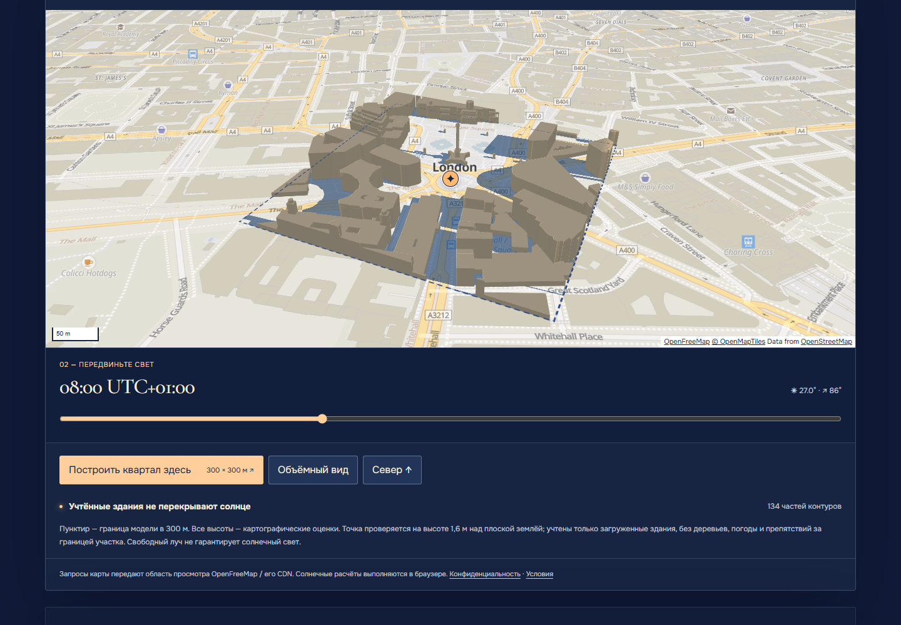

# Helio / атлас дневного света

[Открыть Helio](https://moyisey.github.io/helio/) · [Исходный код](https://github.com/MOYISEY/helio)

Helio помогает выбрать время и точку для съёмки на улице: показывает положение солнца, световые интервалы и примерную тень от зданий вокруг выбранного места. Это интерактивная карта на React, TypeScript, MapLibre и Three.js с расчётами на устройстве пользователя.



[Мобильный экран](evidence/screenshots-map-final/mobile-morning-panel.png) · [Вечерний пример](evidence/screenshots-map-final/desktop-evening-panel.png)

Выберите один из девяти городов, укажите улицу или двор щелчком по карте, перетаскиванием маркера, клавиатурой либо кнопкой «Выбрать центр карты». Затем нажмите «Построить квартал здесь» и перемещайтесь по шкале местного дня. При переносе точки сохраняется явно выбранный часовой пояс IANA — при переходе в другой регион его нужно проверить. Режим открытого горизонта с двумерной панорамой доступен отдельно.

## Запуск и проверка

Нужны Node.js 24 и npm:

```sh
npm ci
npm run dev
npm test
npm run build
npm run preview -- --port 5176
```

`npm run dev` запускает локальный сервер; `npm run preview` показывает собранную версию. Сборка в отслеживаемом каталоге `docs/` публикуется через GitHub Pages из ветки `main`; базовый путь Vite — `/helio/`. Тесты используют встроенную обработку TypeScript в Node 24. Для локальных браузерных проверок нужен Playwright и его браузеры либо `PLAYWRIGHT_BROWSERS_PATH` / `PLAYWRIGHT_BROWSER_EXECUTABLE_PATH`. CI выполняет установку, модульные тесты и сборку без ключей и платных сервисов.

## Как устроено

- `src/App.tsx` управляет выбором места, времени, языка и режимов; карта и 3D-сцена загружаются отдельно.
- `src/solar.ts`, `src/state.ts`, `src/export.ts` рассчитывают солнечные интервалы, проверяют входные данные и создают JSON/ICS.
- `src/MapPanel.tsx`, `src/buildings.ts`, `src/ShadowLayer.ts` читают уже загруженные в карте векторные тайлы, строят ограниченную модель зданий и рассчитывают тень. `src/Scene.tsx` отвечает за отдельный режим открытого горизонта.

После команды «Построить окружение» Helio собирает контуры зданий внутри границы 300 × 300 м. Направленный источник света создаёт карту теней; для выбранной точки на высоте 1,6 м дополнительно проверяется луч к солнцу относительно тех же зданий. Перемещение шкалы обновляет свет без повторного построения зданий. При скрытой вкладке или выходе сцены за экран рендеринг приостанавливается.

В рабочем стиле [Liberty](https://tiles.openfreemap.org/styles/liberty) источник `openmaptiles`, слой `building` и свойства `render_height`, `render_min_height`, `hide_3d` определяются через `map.getStyle()`. [TileJSON](https://tiles.openfreemap.org/planet) описывает OpenMapTiles 3.16.0 и тайлы зданий масштабов 13–14. `querySourceFeatures` возвращает обрезанные фрагменты и дубликаты из уже загруженной части карты, а не полный список препятствий. Фрагменты с общим устойчивым ID и одинаковой высотой/основанием объединяются с сохранением отверстий и мультиполигонов; без ID удаляются лишь точные геометрические дубликаты. Скрытые 3D-контуры исключаются. Лимиты входных данных, частей и вершин приводят к явному состоянию неполноты.

Итоговый предел контура — 8192 замкнутые точки, не более 98 304 вершин в неиндексированных буферах зданий плюс четыре позиции поверхности земли; предел частей — 240. Светлые крыши, более тёмные стены, холодные синие тени и спокойная подложка помогают читать модель, не меняя геометрию. У маркера размер 26 px и область касания 44 × 44 px.

## Точность и ограничения

**Все высоты зданий на живой карте — картографические оценки.** Исходное происхождение `render_height` неизвестно; некорректные или отсутствующие значения условно заменяются на 9 м высоты и 0 м основания, и такие случаи считаются в интерфейсе. Высоты не представлены как измеренные. Модель предполагает плоскую землю и учитывает только загруженные здания: деревья, погоду, рельеф, отсутствующие здания и препятствия за границей не учитывает. Отсутствие контуров означает недостаточно данных, а не пустую улицу.

Возможные состояния точки: солнце ниже горизонта; точка внутри здания; тень от загруженного здания; загруженные здания не перекрывают солнце; недостаточно данных. Свободный луч **не гарантирует прямой солнечный свет**. При низком солнце есть предупреждение: здание высотой 100 м при 10° даёт тень около 567 м, дальше пределов модели. Обычные 3D-экструзии карты скрыты и не выдаются за источник теней.

Локальные оси восток/верх/юг преобразуются в оси Меркатора восток/юг/верх; используется единое проверенное направление на солнце. При изменении модели освобождаются меши, материалы и карты теней. При сбое WebGL поиск города и солнечные расчёты продолжают работать с сообщением о недоступной 3D-сцене. Вблизи ±85° широты картографическая проекция заканчивается, но солнечный расчёт сохраняет точные координаты.

Положение солнца вычисляется через [SunCalc 2.1.0](https://github.com/mourner/suncalc/tree/v2.1.0): азимут отсчитывается по часовой стрелке от севера. Для геометрических границ фаз Helio обращает поправку на рефракцию, сохраняя отображаемую видимую высоту. Восход/закат: −0,833°, гражданские сумерки: от −6° до −0,833°, мягкий свет: от −0,833° до +6°. В высоких широтах интервалы могут длиться больше часа или весь день; отсутствие пересечения, полярный день/ночь и зимние сумерки различаются.

Temporal задаёт действительные границы суток IANA, включая дни длиной 23/25 часов и пропущенные даты. Шкала использует прошедшие минуты; повторяющиеся часы различаются смещением UTC. Интерфейс округляет минуты, JSON сохраняет точные моменты UTC, ICS создаёт событие на 30 минут. Времена солнечных событий рассчитаны для открытого горизонта и стандартной рефракции отдельно от проверки луча на зданиях; см. [определения USNO](https://aa.usno.navy.mil/faq/RST_defs).

Допустимые даты: 1900–2100. Координаты должны быть конечными числами в пределах ±90° широты и ±180° долготы, пояс — действительным IANA. Некорректные параметры URL (`city`, `zone`, `date`, `time`, `lang`, `view=2d`) восстанавливаются с уведомлением; несуществующее и неоднозначное местное время отклоняется. Координаты не добавляются в создаваемые ссылки.

## Карта и приватность

[OpenFreeMap](https://openfreemap.org/quick_start/) и его CDN отдают карту без ключей и учётной записи. В интерфейсе есть ссылки на [OpenFreeMap](https://openfreemap.org/), [OpenMapTiles](https://www.openmaptiles.org/) и [OpenStreetMap](https://www.openstreetmap.org/copyright). Запросы раскрывают провайдеру/CDN область просмотра и обычные сетевые данные; см. [политику приватности](https://openfreemap.org/privacy/) и [условия](https://openfreemap.org/tos/). Гарантии доступности сервиса нет.

Карта загружает только тайлы текущего окна. Overpass, Nominatim, внешний геокодер, сбор тайлов офлайн и автоматические снимки картографических данных не используются. Поиск города — локальный список из девяти городов, не адресный поиск. При сетевом сбое точка и план остаются, а карта/данные зданий отмечаются недоступными. Сбой загрузки одного тайла не позволяет считать частичную модель полной даже после изменения времени. «Загрузить карту заново» пересоздаёт карту, сохраняя точку, дату и время.

Солнечные расчёты локальные. Нет автоматического сохранения, аналитики, геолокации и собственного сервера; код и шрифты размещены вместе с сайтом. Сохранение происходит только по явному действию `helio.saved-plan.v1` с отдельным восстановлением и удалением. JSON/ICS, скачанные пользователем, содержат координаты и часовой пояс. Переходы по ссылкам на провайдера и исходники явные.

## Проверки и права

[Аудит карты: код, геометрия и безопасность](evidence/audit-map-code.md), [дизайн, доступность и производительность](evidence/audit-map-design.md), [независимая публичная регрессия](evidence/audit-map-final.md), [QA публичной карты и парные GPU-кадры](evidence/live-map-qa.md) описывают выпуск карты и границы проверок. [Численный аудит базовой версии](evidence/audit-numerical.md), [аудит дизайна](evidence/audit-design.md) и [QA базовой версии](evidence/live-qa.md) относятся к более раннему режиму открытого горизонта.

В тестах использованы сохранённые исходные USNO/JPL-данные, поскольку прямой текущий USNO API был недоступен. Проверка браузера с мобильным размером окна и касанием не равна физическому телефону или установленному Safari; axe не заменяет проверку скринридером. Reduced motion отключает плавность камеры; DPR ограничен 1,5, кастомный слой рисуется лишь при обновлениях. Художественный мир открытого горизонта не калиброван по углу каждого пикселя. Сцена создана без скопированных ассетов. Родительский и отдельный визуальный рецензенты просмотрели референсные видео; Windows-исполнитель не смог открыть их после сбоя Library-помощника, что было явно принято как исключение.

Лицензии сторонних библиотек и шрифтов перечислены в [THIRD_PARTY_NOTICES.txt](THIRD_PARTY_NOTICES.txt) и публичной сборке. Отдельной лицензии на исходный код Helio в репозитории нет.
